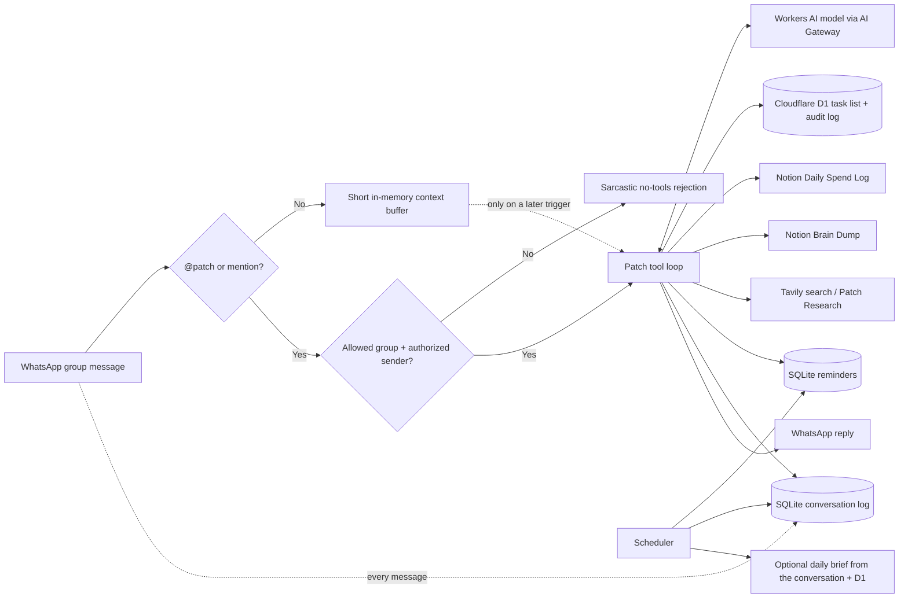

# Captain Patch

[](https://github.com/sagnik11/dia-whatsapp-bot/actions/workflows/ci.yml)
[](https://nodejs.org/)
[](LICENSE)

Captain Patch is an open-source, self-hosted WhatsApp chief of staff for a founding team. It keeps the company task list in **Cloudflare D1**, thinks with an **open-source model on Workers AI routed through Cloudflare AI Gateway**, remembers the group's own conversation so its answers and briefs are grounded in what you actually said, logs founder spending, captures ideas in a Notion Brain Dump, understands voice notes, screenshots, and PDFs, and only speaks unprompted for reminders you explicitly set.

It is Autter's sarcastic harbour-master mascot out of the box, but the personality and company context live in one small file and can be replaced for another team.

```text
@patch add tasks: renew the domain by Friday, Tanvi to call Rahul about the pilot
@patch what's overdue?
@patch mark #12 done and move #14 to blocked — waiting on the CA
@patch delete task 9
@patch add to spend log: chai 120 upi, auto 260 cash
@patch put this in the brain dump: onboarding should start with a repo scan
@patch turn the quoted meeting notes into tasks
@patch what did we decide about pricing yesterday?
@patch capture everything we agreed today as tasks
@patch research AI code-review pricing and add it to the brain dump
```

The roadmap for growing Patch into a full chief of staff lives in [`docs/chief-of-staff-plan.md`](docs/chief-of-staff-plan.md).

> [!WARNING]
> This project uses [`whatsapp-web.js`](https://github.com/pedroslopez/whatsapp-web.js), an unofficial automation layer for WhatsApp Web. It is not endorsed or supported by Meta. WhatsApp can change its protocol, log out the linked session, or restrict the account. Use a dedicated, non-critical number and review WhatsApp's terms before deploying it.

## Contents

- [What it does](#what-it-does)
- [How it works](#how-it-works)
- [Quick start with Docker](#quick-start-with-docker)
- [Configure Cloudflare](#configure-cloudflare)
- [The task list](#the-task-list)
- [The group conversation](#the-group-conversation)
- [Configure Notion (spend log and Brain Dump)](#configure-notion-spend-log-and-brain-dump)
- [Find group and sender IDs](#find-group-and-sender-ids)
- [Enable web search](#enable-web-search)
- [Environment variables](#environment-variables)
- [Deployment](#deployment)
- [Privacy and security model](#privacy-and-security-model)
- [Known limitations](#known-limitations)
- [Troubleshooting](#troubleshooting)
- [Development](#development)

## What it does

- Listens in WhatsApp **group chats**, responds only when triggered, and accepts commands only from allowlisted senders.
- Keeps Autter's **task list in Cloudflare D1**: create (single or batch), search and filter, edit any field, append notes, complete, and delete, with an audit trail of every change.
- Runs on an **open-source model** (default `@cf/moonshotai/kimi-k2.6`) through **Cloudflare AI Gateway**, with automatic fallback to a second model (default `@cf/google/gemma-4-26b-a4b-it`) when the primary is rate limited or down.
- Keeps the **group conversation** locally (90 days by default) so Patch can answer "what did we decide?", turn a discussion into tasks, and write briefs from what was actually said.
- Logs and totals founder expenses in the Notion **Daily Spend Log**.
- Reads and appends to the Notion **Brain Dump** page, including "research this and save it there".
- Understands screenshots (vision), PDFs and Office documents (converted to Markdown by Workers AI), and voice notes (transcribed locally with `whisper.cpp`).
- Drafts emails, investor updates, JDs, agendas, follow-ups, and summaries on request.
- Stores persistent personal reminders in SQLite (advance, due-time, and optional repeats).
- Sends **one** daily brief at 09:00 (on by default) written from the conversation since the last brief, cross-checked against D1 tasks and reminders, and skipped when the group was quiet. There is no periodic task digest and no Notion task notifications.
- Optionally performs bounded Tavily web search and multi-search delegated research with citations.
- Optionally reads the live Dekhte Hai script library and company Notion pages (both off by default).

## Captain Patch and Autter

The default persona is Captain Patch, [Autter's](https://autter.dev/) suspicious harbour master. Patch is dry, highly sarcastic, and unimpressed by bad code, vague plans, avoidable chaos, and meetings that should have been messages. Patch is calm and gentle with Sagnik and performs an intentionally annoying comic rivalry with Tanvi without changing her equal permissions or the quality of her results. Serious or sensitive messages always drop the rivalry. The prompt explicitly keeps the humour non-abusive and requires the useful answer to win over the joke. The persona from before this founder-specific variation is preserved in [`docs/prompts/captain-patch-original.md`](docs/prompts/captain-patch-original.md).

The included context describes Autter as an independent assurance layer and merge gate for the AI coding era. It also records Sagnik Ghosh and Tanvi as equal co-founders and close friends. This context is used only as assistant background; WhatsApp authorization still depends exclusively on resolved sender IDs, never names.

To adapt the project for your own organization, see [Customizing the bot](#customizing-the-bot).

## How it works



Every write (tasks, spends, Brain Dump, reminders) is confirmed to the group from the stored result, not from model prose, so Patch cannot claim it did something it did not do. When a message clearly asks for an action, the first model turn is required to call a tool. Task edits and deletes are only accepted for an `#id` the founder named or that `list_tasks` returned in the same request, so the model cannot act on a guessed id.

## Requirements

- Node.js 24+ or Docker with Compose
- A dedicated or non-critical WhatsApp account
- A Cloudflare account with **Workers AI** (the default Kimi K2.6 model needs Workers Paid or AI Gateway credits) and a **D1** database
- A Notion internal integration only if you use the spend log, Brain Dump, knowledge, or script features
- Optional: a [Tavily API key](https://app.tavily.com/) for web search and research

## Quick start with Docker

```bash
git clone https://github.com/sagnik11/dia-whatsapp-bot.git
cd dia-whatsapp-bot
cp .env.example .env
```

Fill in the required values in `.env` (see [Configure Cloudflare](#configure-cloudflare)):

```dotenv
CLOUDFLARE_ACCOUNT_ID=your_account_id
CLOUDFLARE_API_TOKEN=token_with_workers_ai_read_and_d1_edit
CLOUDFLARE_AI_GATEWAY_ID=patch
CLOUDFLARE_D1_DATABASE_ID=your_d1_database_uuid

# Optional Notion features
NOTION_API_KEY=your_notion_integration_token
NOTION_SPEND_DATA_SOURCE_ID=your_spend_log_data_source_id
NOTION_SPEND_PAYER_MAP_JSON={"sagnik":"notion-user-id-1","tanvi":"notion-user-id-2"}
NOTION_BRAIN_DUMP_PAGE_ID=your_brain_dump_page_id

BOT_NAME=Captain Patch
BOT_TRIGGER=@patch
TIMEZONE=Asia/Kolkata
```

Build and run in the foreground for the first pairing:

```bash
docker compose up --build dia
```

When the QR code appears:

1. Open WhatsApp on the bot's phone.
2. Go to **Linked devices**.
3. Select **Link a device**.
4. Scan the QR code displayed in the terminal.
5. Wait for `Captain Patch is connected to WhatsApp`.

Stop the foreground process with `Ctrl+C`, configure the group and authorized senders as described below, and start it continuously:

```bash
docker compose up -d
docker compose logs -f --since 2m dia
```

The `dia-data` Docker volume stores the WhatsApp linked-device session and SQLite deduplication database. Rebuilding the container does not normally require scanning another QR.

## Run directly with Node.js

For local development or a host with Chrome/Chromium already available:

```bash
git clone https://github.com/sagnik11/dia-whatsapp-bot.git
cd dia-whatsapp-bot
npm install
cp .env.example .env
npm run dev
```

If Puppeteer cannot locate a browser, set `PUPPETEER_EXECUTABLE_PATH` to the Chrome or Chromium executable.

## Configure Cloudflare

1. **D1 database.** Use your existing database or create one with `npx wrangler d1 create patch`. Copy its UUID into `CLOUDFLARE_D1_DATABASE_ID`. Patch creates its `tasks` and `task_events` tables on startup; to create them ahead of time run `npx wrangler d1 execute <database-name> --remote --file=migrations/0001_tasks.sql`.
2. **AI Gateway.** In the dashboard, open **AI > AI Gateway** and create a gateway (for example `patch`). Set `CLOUDFLARE_AI_GATEWAY_ID` to its name. `default` also works and is created automatically. Turn on logging, and consider rate limiting and a spend alert there.
3. **API token.** Create a token under **My Profile > API Tokens** with **Account > Workers AI > Read** and **Account > D1 > Edit** for this account. Put it in `CLOUDFLARE_API_TOKEN`. To keep D1 and AI permissions separate, set `CLOUDFLARE_D1_API_TOKEN` to a second, D1-only token.
4. **Models.** Defaults are `CLOUDFLARE_AI_MODEL=@cf/moonshotai/kimi-k2.6` (262k context, tool calling, vision) and `CLOUDFLARE_AI_FALLBACK_MODEL=@cf/google/gemma-4-26b-a4b-it` (cheaper, higher rate limit, tools and vision). Any Workers AI model with function calling can be swapped in. `CLOUDFLARE_AI_REASONING_EFFORT=none` keeps WhatsApp replies fast; set `high` for slower, more deliberate answers.

Patch calls `https://api.cloudflare.com/client/v4/accounts/<account>/ai/v1/chat/completions` with a `cf-aig-gateway-id` header, so every request shows up in AI Gateway logs and analytics, tagged with a feature name and a hashed sender id (never a phone number).

## The task list

Tasks live in the D1 `tasks` table with an id, title, notes, status (`todo`, `in_progress`, `blocked`, `done`, `cancelled`), priority, owner, area, due date, and tags. Every create, update, and delete is also written to `task_events` with the actor and a before/after diff.

```text
@patch add a high-priority task for me to send the investor update by Friday
@patch capture these as tasks: 1. renew domain 2. GST filing for Sagnik 3. Tanvi to brief the designer
@patch which tasks does Tanvi own that are due this week?
@patch what's blocked?
@patch move #7 to in progress and add a note: CA replied, need PAN copy
@patch rename task 4 to "Ship onboarding v2" and clear its due date
@patch delete tasks 11 and 12
```

- "me" as an owner means the sender. Relative dates resolve in `TIMEZONE`.
- Notes are appended by default and replaced only when you explicitly ask.
- Deleting is a soft delete: the task disappears from every list but stays in D1, with its last snapshot recorded in `task_events`.
- A message retried by WhatsApp will not create duplicate tasks.
- Patch never posts task digests. You see the list when you ask, plus the optional daily brief.

## The group conversation

Patch keeps every message in its allowed groups, plus its own replies, in the local SQLite database on your server for `CONVERSATION_RETENTION_DAYS` (default 90). Nothing from this log goes to D1 or Notion. It is sent to the model only when a founder asks about earlier discussion or when the daily brief is written.

```text
@patch what did we decide about pricing on Monday?
@patch catch me up on today
@patch what did Tanvi promise Rahul?
@patch capture everything we agreed today as tasks
@patch minutes of this morning's discussion
```

- Answers are grounded in the returned messages and attribute each point to whoever said it; if the log does not cover something, Patch says so.
- Patch only reads the log of the group it was asked in, at most a week back per request.
- Voice notes are logged as `[ptt attachment]` unless someone asks Patch about them.
- Set `CONVERSATION_RETENTION_DAYS=0` to turn the log off (then also set `FOUNDER_BRIEF_TIME=` empty).

## Configure Notion (spend log and Brain Dump)

Notion is now optional and limited to the spend log and Brain Dump (plus the off-by-default knowledge and script readers). It holds no tasks. Create an internal integration and connect it only to the pages and databases below.

### Founder spend log

Connect the same Notion integration to a separate expense database and set its **data source ID**:

```dotenv
NOTION_SPEND_DATA_SOURCE_ID=your_spend_log_data_source_id
# Optional; falls back to NOTION_ASSIGNEE_MAP_JSON when blank.
NOTION_SPEND_PAYER_MAP_JSON={"sagnik":"notion-user-id-1","tanvi":"notion-user-id-2"}
```

The database schema is intentionally fixed so amounts and totals remain reliable:

| Property | Notion type | Expected values |
| --- | --- | --- |
| `Spend` | Title | Purchase description |
| `Amount` | Number | INR amount |
| `Date` | Date | Transaction date |
| `Paid by` | People | Founder from the payer map |
| `Payment method` | Select | `Company card`, `Personal card`, `UPI`, `Bank transfer`, `Cash` |
| `Category` | Select | `Travel`, `Software & SaaS`, `Hosting & Infrastructure`, `Meals`, `Marketing`, `Contractors`, `Office`, `Legal & Finance`, `Other` |
| `Vendor` | Text | Optional merchant |
| `Notes` | Text | Optional context plus a private retry reference |
| `Reimbursable` | Checkbox | Defaults to false unless explicitly stated |

Patch accepts a single transaction or a numbered bulk list, creates one Notion row for each expense, resolves relative dates in `TIMEZONE`, and confirms the created count and INR total. Each row gets a hashed reference derived from the WhatsApp message and item position; replaying the same message skips rows already created instead of duplicating them. A newly retyped message is treated as a new instruction.

```text
@patch add to daily spend log:
Expenses by Tanvi:
1. 12th aug: chai 100rs upi
2. 12th aug: bookbar 253rs upi

@patch how much did Tanvi spend on travel this month?
@patch show our expenses from 10 August to 13 August
```

The integration needs **Read content** and **Insert content** access to this database. The model uses the closest configured category and chooses `Other` when uncertain; it asks for clarification instead of guessing a genuinely ambiguous date or amount.

### Brain Dump

To let Captain Patch answer questions from one Notion page, add the same internal integration as a connection to that page and set:

```dotenv
NOTION_BRAIN_DUMP_PAGE_ID=your_notion_page_id
```

The page can be a regular Notion page; it does not need to be a database. Captain Patch reads it only when an authorized founder asks about its contents and appends only when explicitly told to add something. The integration needs **Read content** and **Update content** capabilities plus access to the page. Existing content cannot be replaced, edited, or deleted through the bot. Reads are capped at 12,000 characters per model request. Appends have no application-level total-character ceiling: Patch divides unusually large Markdown into ordered Notion requests while preserving the complete note. General workspace search remains disabled unless the separate setting below is enabled.

If one message asks Patch to research and save the result, Patch runs the research agent first and then appends two clearly separated sections: the founder's complete original notes and Patch's complete cited report.

Examples:

```text
@patch summarize the Brain Dump
@patch add this to the Brain Dump: make the first repository review memorable
@patch append the quoted feedback to the Brain Dump under Onboarding
@patch research these launch ideas and add my complete notes and your findings separately to the Brain Dump
```

### Optional company knowledge access

Set this only after reviewing the integration's **Content access** in the Notion developer portal:

```dotenv
NOTION_KNOWLEDGE_ENABLED=true
```

This exposes read-only assistant tools that search page/database titles shared with the integration, read matched pages, and inspect the five most recently edited rows of matched databases. A page can be read only after its ID was returned by a search in the same WhatsApp request. The bot permits one title search and two resource reads per request; page bodies are capped at 12,000 characters.

The public Notion API does not provide a teamspace filter. To scope this to one teamspace such as Autter HQ, connect the integration only to that teamspace's top-level pages and databases. Sharing a parent page includes its descendants. If some databases are separate top-level sidebar entries, add each one to the integration's Content access as well.

Examples:

```text
@patch search Autter HQ for our company goals
@patch what does our Notion say about expenses?
@patch summarize the latest weekly product update from company knowledge
```

The optional Dekhte Hai script reader is enabled by `NOTION_SCRIPT_SOURCE_MAP_JSON`, which maps each data-source ID to its title property. It fetches every current `Dekhte Hai Ep N` page whenever the series is mentioned.

## Voice notes, screenshots, and PDFs

Screenshots and photos go to the model as vision input. PDFs and Office documents are converted to Markdown with Workers AI's `toMarkdown` endpoint (set `CLOUDFLARE_DOCUMENT_CONVERSION=false` to turn this off), so open models can read them. A document that cannot be converted does not drop your message; Patch just says it could not read the file. Send media with an `@patch` caption, or reply to a media message with an `@patch` command.

Voice notes are transcribed first by a private [`whisper.cpp`](https://github.com/ggml-org/whisper.cpp) service in Docker Compose. Because WhatsApp voice notes do not carry a normal text caption, reply to the voice note with `@patch summarize this` (or another command).

```dotenv
WHISPER_MODEL=tiny
WHISPER_THREADS=2
WHISPER_LANGUAGE=auto
MEDIA_MAX_BYTES=5000000
```

The default multilingual `tiny` model is about 75 MiB on disk and uses roughly 273 MB of memory. Change `WHISPER_MODEL=base` for better accuracy at the cost of slower CPU inference, about 142 MiB on disk, and roughly 388 MB of memory. The model is downloaded once into the `whisper-models` Docker volume. Audio never goes to a transcription API; the model receives only the resulting transcript. Transcripts, images, and documents are treated as untrusted user content.

## Reminders and the daily brief

Reminders are stored in the same persistent SQLite file as message deduplication, so container rebuilds and restarts do not erase them. By default Patch asks the model to schedule an advance notification ten minutes before the due time and another when due. Repetition is added only when explicitly requested and continues until cancelled.

```text
@patch remind me to send the investor update tomorrow at 4 PM
@patch remind me every 30 minutes after 6 PM to check the launch
@patch show my reminders
@patch mark reminder number 7 as completed
@patch cancel reminder 12
```

The reminder confirmation includes its numeric ID. Marking a reminder completed stops all future notifications, including repeats. A reminder belongs to the WhatsApp group where it was created, and completion or cancellation is limited to that group.

### Daily brief

```dotenv
FOUNDER_BRIEF_TIME=09:00
FOUNDER_BRIEF_GROUP_IDS=120363000000000000@g.us
```

The brief is on by default at 09:00 in `TIMEZONE`; set `FOUNDER_BRIEF_TIME=` empty to turn it off, and Patch then never posts anything you did not ask for except your own reminders. Patch sends one brief per day written from the group conversation since the previous brief: what came up, what was decided, who committed to what (flagging commitments not yet on the task list), open questions, and the D1 tasks that are due or were discussed. If only Patch spoke since the last brief, no brief is sent and the next one covers the gap (up to three days). The old `TASK_DIGEST_*` and `NOTION_WEBHOOK_*` settings have been removed.

## Find group and sender IDs

### Group allowlist

With `LIST_GROUPS_ON_START=true`, startup logs show joined group names and IDs:

```text
{"groupId":"120363000000000000@g.us","groupName":"Example","msg":"Available WhatsApp group"}
```

Set one or more comma-separated IDs:

```dotenv
ALLOWED_GROUP_IDS=120363000000000000@g.us
LIST_GROUPS_ON_START=false
```

If `ALLOWED_GROUP_IDS` is empty, every joined group is eligible. A production deployment should normally use an explicit allowlist.

### Authorized senders

`AUTHORIZED_USER_IDS` is required in practice: when it is empty, every trigger is rejected.

To discover an owner's identifiers:

1. Start the bot and follow its logs.
2. Ask the owner to send `@patch hello` in an allowed group.
3. Find the `Ignored trigger from unauthorized sender` entry.
4. Copy all relevant values from its `senderIds` array.
5. Add every owner account as a comma-separated value.

Example with two owners:

```dotenv
AUTHORIZED_USER_IDS=123456789@lid,919999999999@c.us,919999999999,987654321@lid,918888888888@c.us,918888888888
```

WhatsApp may represent the same person using both `@lid` and `@c.us` identifiers. Include the variants observed in your logs. Display names are deliberately never used for authorization.

Messages manually sent from the WhatsApp account linked to the bot are also supported when that account's ID is included in the allowlist.

## Enable web search

Live search is optional:

```dotenv
TAVILY_API_KEY=tvly-your-key
RESEARCH_MAX_SEARCHES=3
```

When configured, Patch has two modes:

- Quick lookup: one bounded search for a current fact or URL.
- Delegated research: one specialist run with up to `RESEARCH_MAX_SEARCHES` distinct searches, a cited report, explicit unknowns, and a recommendation.

Authorized assistant and research responses do not set an application-level output-token ceiling. Long standalone reports are delivered as consecutive, paragraph-aware WhatsApp messages instead of being discarded or shortened.

Examples:

```text
@patch research the best places to launch Autter to developers
@patch do a competitive analysis of AI code review tools
@patch research publishing channels and add the findings to the brain dump
```

Every individual Tavily call still uses these server-enforced limits:

- At most one Tavily request per triggered WhatsApp message
- Basic search depth
- At most five results
- No raw page content, answer generation, or images
- A 15-second timeout
- At most 1,200 characters retained from each result

This keeps cost and model context bounded. Without a Tavily key, the assistant continues to work but must say that live browsing is unavailable when asked for current information.

## Environment variables

Copy [`.env.example`](.env.example) and change only what your deployment needs.

| Variable | Required | Default | Purpose |
| --- | --- | --- | --- |
| `CLOUDFLARE_ACCOUNT_ID` | Yes | — | Cloudflare account that owns Workers AI, AI Gateway, and D1. |
| `CLOUDFLARE_API_TOKEN` | Yes | — | Token with Workers AI Read and D1 Edit. |
| `CLOUDFLARE_AI_GATEWAY_ID` | No | `default` | AI Gateway name used for logs, caching, rate limits, and analytics. |
| `CLOUDFLARE_AI_MODEL` | No | `@cf/moonshotai/kimi-k2.6` | Primary Workers AI model; must support function calling. |
| `CLOUDFLARE_AI_FALLBACK_MODEL` | No | `@cf/google/gemma-4-26b-a4b-it` | Used when the primary returns 429/5xx. Empty disables fallback. |
| `CLOUDFLARE_AI_REASONING_EFFORT` | No | `none` | `none`, `high`, or empty for the model default. |
| `CLOUDFLARE_AI_TIMEOUT_MS` | No | `120000` | Per-request model timeout. |
| `CLOUDFLARE_D1_DATABASE_ID` | Yes | — | D1 database UUID for the task list. |
| `CLOUDFLARE_D1_API_TOKEN` | No | `CLOUDFLARE_API_TOKEN` | Optional separate D1-only token. |
| `CLOUDFLARE_DOCUMENT_CONVERSION` | No | `true` | Convert PDFs and documents to Markdown with Workers AI. |
| `WHISPER_MODEL` | No | `tiny` | Local whisper.cpp model downloaded by Compose; `base` is more accurate. |
| `WHISPER_THREADS` | No | `2` | CPU threads for local transcription. |
| `WHISPER_LANGUAGE` | No | `auto` | Spoken-language hint. |
| `WHISPER_TIMEOUT_MS` | No | `180000` | Maximum transcription duration. |
| `WHISPER_TRANSCRIPTION_URL` | No | Compose-managed | whisper.cpp URL for non-Compose runs. |
| `NOTION_API_KEY` | With Notion features | Empty | Notion integration token. |
| `NOTION_SPEND_DATA_SOURCE_ID` | No | Empty | Enables the Daily Spend Log. |
| `NOTION_SPEND_PAYER_MAP_JSON` | With spend log | `NOTION_ASSIGNEE_MAP_JSON` | Payer names to Notion user IDs. |
| `NOTION_BRAIN_DUMP_PAGE_ID` | No | Empty | Enables Brain Dump reads and appends. |
| `NOTION_KNOWLEDGE_ENABLED` | No | `false` | Read-only search over everything shared with the integration. |
| `NOTION_SCRIPT_SOURCE_MAP_JSON` | No | `{}` | Enables the live Dekhte Hai script reader. |
| `NOTION_SCRIPT_SERIES_NAME` | No | `Dekhte Hai` | Series name used to find episode pages. |
| `TAVILY_API_KEY` | No | Empty | Enables web lookup and delegated research. |
| `RESEARCH_MAX_SEARCHES` | No | `3` | Searches per research run (1–5). |
| `BOT_NAME` | No | `Captain Patch` | Name supplied to the model and logs. |
| `BOT_TRIGGER` | No | `@patch` | Case-insensitive text trigger. |
| `TIMEZONE` | No | `Asia/Kolkata` | IANA timezone for relative dates. |
| `ALLOWED_GROUP_IDS` | Recommended | Empty | Comma-separated group IDs; empty allows all joined groups. |
| `AUTHORIZED_USER_IDS` | Yes for use | Empty | Comma-separated owner IDs; empty blocks everyone. |
| `UNAUTHORIZED_REPLY` | No | Harbour-themed | Used if the AI rejection fails. |
| `CONTEXT_MESSAGE_LIMIT` | No | `6` | Recent group messages kept in memory (0–20). |
| `CONVERSATION_RETENTION_DAYS` | No | `90` | Days of group conversation kept locally for briefs and look-backs; `0` turns the log and the brief off. |
| `FOUNDER_BRIEF_TIME` | No | `09:00` | Daily brief time `HH:mm`; set it empty to turn the brief off. |
| `FOUNDER_BRIEF_GROUP_IDS` | No | `ALLOWED_GROUP_IDS` | Daily brief destinations. |
| `MEDIA_MAX_BYTES` | No | `5000000` | Maximum decoded attachment size. |
| `LIST_GROUPS_ON_START` | No | `true` | Logs group names/IDs after connecting. |
| `DATA_DIR` | No | `.data` | WhatsApp session and SQLite directory outside Docker. |
| `LOG_LEVEL` | No | `info` | Pino log level. |
| `PUPPETEER_EXECUTABLE_PATH` | No | Auto | Chrome/Chromium executable. Docker sets `/usr/bin/chromium`. |

### Upgrading from the Azure + Notion-tasks version

Remove `AZURE_OPENAI_*`, `NOTION_DATA_SOURCE_ID`, the `NOTION_*_PROPERTY` names, `NOTION_DEFAULT_STATUS`, `NOTION_DEFAULT_ASSIGNEE_ID`, `TASK_DIGEST_*`, and `NOTION_WEBHOOK_*` / `NOTION_NOTIFICATION_GROUP_IDS` / `NOTION_NOTIFY_BOT_EVENTS`, then add the `CLOUDFLARE_*` values above. Existing Notion tasks are not migrated automatically; paste a list and ask Patch to "capture these as tasks" to bring some across.

## Deployment

Captain Patch needs a continuously running process. Your laptop does not need to stay on when the bot runs on a VPS.

For a full Ubuntu deployment—including Docker installation, SSH key use, terminal QR pairing, firewall guidance, updates, and backups—see [Deploy Captain Patch on Amazon Lightsail](docs/lightsail.md).

Update an existing Docker deployment with:

```bash
git pull --ff-only origin main
docker compose build --no-cache
docker compose up -d --force-recreate --remove-orphans
docker compose logs -f --since 2m dia
```

Do not run `docker compose down --volumes` unless you intentionally want to remove the saved WhatsApp session, deduplication/reminder database, and Whisper model cache.

## Customizing the bot

1. Change `BOT_NAME` and `BOT_TRIGGER` in `.env`.
2. Replace `CAPTAIN_PATCH_PERSONA`, `AUTTER_CONTEXT`, and `CHIEF_OF_STAFF_ROLE` in [`src/captain-patch.ts`](src/captain-patch.ts).
3. Change `UNAUTHORIZED_REPLY` in `.env`.
4. Adjust task areas in [`src/task-store.ts`](src/task-store.ts) if your team uses different ones.
5. Run `npm run check` and `npm run build` before deploying.

Do not put API keys, private customer data, phone numbers, or other secrets into the persona file. It is included in every model request and committed to source control.

## Privacy and security model

- Authorization uses WhatsApp sender IDs, not editable profile names; group and sender allowlists are checked before any tool is exposed. The unauthorized rejection call has no tools.
- Task edits and deletes require an `#id` the founder named or one returned by `list_tasks` in the same request; deletes are soft and audited in `task_events`.
- Writes are confirmed from stored data, not model text.
- Brain Dump writes can only append to the one configured page. Company knowledge is opt-in and read-only.
- Group context, quoted messages, attachments, transcripts, Notion content, D1 rows, and web results are all treated as untrusted data in the system prompt.
- Model requests go to Workers AI through your AI Gateway. Gateway logs can contain prompts and replies; set log retention to match your comfort level. Gateway metadata carries only a feature name and a hashed sender id.
- Every message in allowed groups (and Patch's replies) is stored in local SQLite for `CONVERSATION_RETENTION_DAYS` and pruned after that. It is sent to the model only when a founder asks about earlier discussion or for the daily brief, and only for the group it came from. Set the retention to `0` to store nothing.
- Up to `CONTEXT_MESSAGE_LIMIT` recent group messages are also included with each trigger (never for task capture unless a founder asks to capture the discussion).
- Reminders, dedupe state, and the conversation log live in local SQLite in the `dia-data` volume, which also holds the WhatsApp session and must be treated as sensitive.

Before adding the bot to a group, tell participants what data may be processed by Cloudflare, Notion, Tavily, and your server logs. Report vulnerabilities privately according to [SECURITY.md](SECURITY.md).

## Known limitations

- WhatsApp integration is unofficial and can break when WhatsApp Web changes. Only group chats are handled.
- The D1 REST API is a control-plane API with a global limit of about 1,200 requests per five minutes per user; that is ample for a founding team, but not for a large org.
- Kimi K2.6 is paid-only and has a lower per-account rate limit than the fallback model; heavy research bursts may fall back to the second model.
- Open models occasionally pick the wrong tool. Writes are guarded and confirmed, so the failure mode is "asks again" or "does nothing", never a silent write to a guessed task.
- Reminder delivery is at-least-once around crashes. Context is in memory and lost on restart.
- SQLite and the WhatsApp session assume a single bot process.

## Troubleshooting

### The bot connects but does not reply

`WhatsApp session authenticated` means only that WhatsApp accepted the saved login. The bot can receive commands only after `<BOT_NAME> is connected to WhatsApp` appears. If authentication succeeds but readiness stalls for two minutes, Patch exits cleanly so Docker can restart it automatically; synchronization progress is logged in between.

Check, in order:

1. The message was sent in a group.
2. It contains the configured text trigger or a real mention of the linked account.
3. The group is present in `ALLOWED_GROUP_IDS`.
4. The sender's observed IDs are present in `AUTHORIZED_USER_IDS`.
5. Logs contain `Received triggered WhatsApp message`.

```bash
docker compose ps
docker compose logs --since 5m dia
```

### An owner receives the unauthorized rejection

Copy every relevant `@lid`, `@c.us`, and raw-number variant from the `senderIds` log entry into `AUTHORIZED_USER_IDS`, then recreate the container so it reloads `.env`:

```bash
docker compose up -d --force-recreate
```

### The task list does not respond

Startup fails fast with a `D1 query failed` log if the database id or token is wrong. Check that `CLOUDFLARE_D1_DATABASE_ID` is the UUID (not the name) and that the token has **D1 > Edit** for the same account.

### The model returns 401 or 403

The token needs **Workers AI > Read**; a token with only AI Gateway permissions is rejected. Kimi K2.6 also requires Workers Paid or AI Gateway credits; switch `CLOUDFLARE_AI_MODEL` to the fallback model to confirm.

### Notion returns 403 or 404

Share the spend-log database and Brain Dump page with the integration, and confirm `NOTION_SPEND_DATA_SOURCE_ID` is a data source ID.

### WhatsApp asks for another QR

The linked session was logged out, invalidated, or removed. Run the service in the foreground and pair again. Avoid deleting the Docker volume during normal updates.

### Chromium crashes or repeatedly restarts

Use the current `main` image, allow stale-profile lock cleanup to run, and ensure the host has enough memory. Chromium and Node.js need at least 2 GB RAM; 4 GB is the safer choice when local Whisper and Chromium run concurrently.

### Web search is unavailable

Confirm `TAVILY_API_KEY` exists inside `.env`, recreate the container, and inspect `Web search failed` log entries. The assistant deliberately does not pretend to browse when Tavily is unavailable.

## Development

```bash
npm install
npm run check
npm run build
```

Individual commands:

```bash
npm run lint
npm run typecheck
npm test
npm run test:watch
```

The suite runs the real task-store SQL against in-memory SQLite (D1's engine), pins the exact AI Gateway and D1 request shapes, and covers tool routing, the edit/delete id guard, deterministic confirmations, model fallback, document conversion, spend-log writes, Brain Dump appends, reminders, scheduling, and research.

## Project structure

```text
src/
├── assistant.ts          Chief-of-staff instructions and tool orchestration
├── authorization.ts      WhatsApp sender-ID normalization and allowlist
├── bot.ts                WhatsApp lifecycle and message routing
├── captain-patch.ts      Replaceable persona, company context, chief-of-staff role
├── cloudflare-d1.ts      D1 REST client
├── config.ts             Validated environment configuration
├── context-buffer.ts     Bounded in-memory group context
├── conversation-store.ts Local group conversation log with retention
├── dedupe-store.ts       SQLite message deduplication
├── document-converter.ts Workers AI PDF/document to Markdown
├── founder-brief.ts      Optional daily brief from the conversation and D1
├── llm.ts                Workers AI chat client via AI Gateway, with fallback
├── media-ingestion.ts    Attachment validation, transcription, conversion
├── notion.ts             Brain Dump, optional knowledge and script readers
├── notion-spend.ts       Founder spend log reads and retry-safe writes
├── reminder-store.ts     Persistent reminders and scheduler state
├── research-agent.ts     Bounded multi-search research specialist
├── scheduler.ts          Reminder delivery and the optional daily brief
├── task-store.ts         D1 task list with audit trail
├── time.ts               Timezone-aware date helpers
└── web-search.ts         Bounded Tavily search service

migrations/0001_tasks.sql   D1 schema
docs/chief-of-staff-plan.md Roadmap
docs/lightsail.md           Production VPS deployment guide
test/                       Vitest test suite
```

## Contributing

Issues and focused pull requests are welcome. Read [CONTRIBUTING.md](CONTRIBUTING.md), add tests for behavioral changes, and run the full check before opening a PR:

```bash
npm run check && npm run build
```

Never include real phone numbers, group IDs, API keys, session files, private messages, or unredacted logs in an issue or commit.

## License

Released under the [MIT License](LICENSE).

Captain Patch and Autter product context are included as the default example persona. If you publish a materially rebranded fork, replace the persona and company context with your own.
