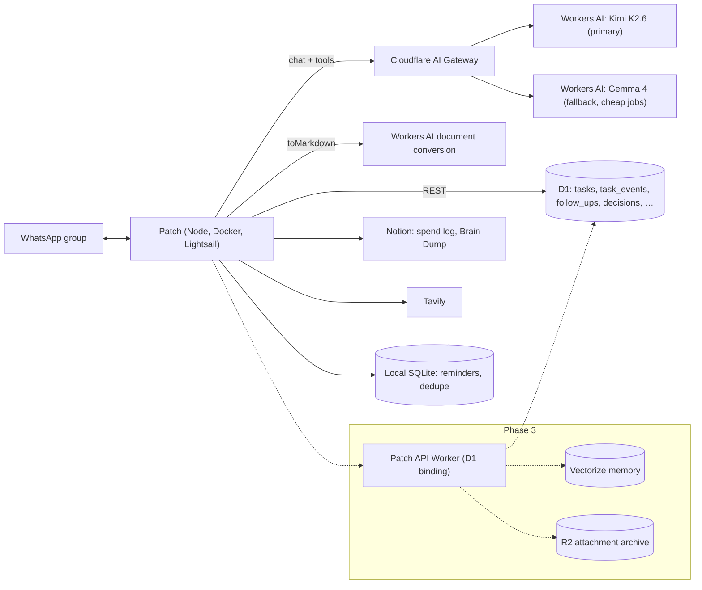

# Captain Patch as Autter's chief of staff

This is the plan for turning Patch from a WhatsApp helper into the person-shaped role every early-stage company needs and cannot yet hire: someone who remembers every commitment, keeps the operating system of the company clean, does the repetitive admin, and hands the founders a short, honest picture of where things stand.

It covers what Patch already does after the Cloudflare migration, what it should do next, how each capability is built, and how we keep it from becoming the nagging bot it replaced.

## 1. Ground rules

These apply to every phase. Each new capability is checked against them before it ships.

1. **Pull, not push.** Patch answers when asked. The only unprompted messages are reminders a founder explicitly set, plus digests a founder explicitly opted into (`FOUNDER_BRIEF_TIME`, and later a weekly review). Default: zero. No more four-hour task digests, no mirroring Notion edits into WhatsApp.
2. **One home per kind of data.** Tasks, follow-ups, decisions, and other operating records live in Cloudflare D1. Money stays in the Notion Daily Spend Log. Raw ideas stay in the Notion Brain Dump. Patch never keeps a second copy that can drift.
3. **Writes are confirmed from stored data.** Every create, update, or delete reply is generated from what D1 or Notion actually returned, never from model prose.
4. **Nothing irreversible without a trace.** Deletes are soft, and every change is recorded with actor and diff (`task_events` today, the same pattern for every new table).
5. **Draft first for anything that leaves the group.** Emails, investor updates, and messages to customers or candidates are drafted in WhatsApp. Sending through an integration always needs an explicit "send it" from a founder.
6. **Least privilege.** Each integration gets the narrowest token that works. Notion is limited to the spend log and Brain Dump; Cloudflare tokens are scoped to Workers AI and D1.
7. **Open models, observable spend.** All model traffic goes through AI Gateway, so cost, latency, errors, and prompts are visible in one place, and limits can be enforced there.

## 2. What ships in this branch (Phase 0)

| Area | Capability | How |
| --- | --- | --- |
| Tasks | Create single or batch tasks from text, quoted messages, voice notes, and PDFs | `create_tasks` → D1 `tasks` |
| Tasks | Search by text, status, owner, area, tag, due range, overdue | `list_tasks` |
| Tasks | Edit title, status, owner, priority, area, due date, tags; append or replace notes; clear fields | `update_tasks` (batch) |
| Tasks | Delete (soft) with audit snapshot | `delete_tasks` → `deleted_at` + `task_events` |
| Tasks | Full history of every change with actor and before/after | `task_events` |
| Safety | Edits and deletes only for an `#id` the founder named or that was just listed | id guard in `assistant.ts` |
| Safety | Action-shaped messages must produce a tool call on the first turn | `tool_choice: required` |
| Money | Log many expenses in one message, query and total spend | Notion Daily Spend Log (unchanged) |
| Ideas | Read the Brain Dump, append notes, and "research X and save it there" | Notion Brain Dump (unchanged) |
| Model | Open-source Kimi K2.6 via AI Gateway, automatic fallback to Gemma 4 on 429/5xx | `llm.ts` |
| Media | Screenshots via vision, PDFs/Office docs via Workers AI `toMarkdown`, voice via local Whisper | `media-ingestion.ts` |
| Research | Bounded web search and multi-search research with citations | Tavily + `research-agent.ts` |
| Rhythm | Personal reminders; optional single daily brief built from D1 | `scheduler.ts` |
| Removed | Notion task tracker, four-hour task digest, Notion webhook notifications, Azure OpenAI | — |

## 3. What a great chief of staff does, mapped to Patch

Each domain lists what Patch will do, the commands founders would actually type, where the data lives, and the phase it lands in.

### 3.1 Execution: tasks, follow-ups, and commitments

The core job: nothing a founder commits to is lost.

| Capability | Example | Data | Phase |
| --- | --- | --- | --- |
| Task capture from anything (text, voice note, PDF, screenshot, quoted message) | "turn this voice note into tasks" | `tasks` | 0 ✅ |
| Owners, due dates, priority, areas, tags | "give #12 to Tanvi, due Friday, high" | `tasks` | 0 ✅ |
| Recurring tasks | "every month on the 5th: pay contractor invoices" | `recurring_tasks` generates `tasks` | 1 |
| Checklists inside a task | "add a checklist to #8: PAN, GST cert, board resolution" | `task_items` | 1 |
| "Waiting on" tracking | "#14 is blocked on the CA — check back Thursday" | `tasks.waiting_on`, `tasks.follow_up_at` | 1 |
| Follow-up tracker for promises made to others | "I told Rahul I'd send the pilot proposal by Friday" | `follow_ups` | 1 |
| Undo the last change | "undo that" | replay `task_events` | 1 |
| Weekly review (opt-in, Monday morning) | done last week, slipped, overdue, unowned, next week's due | read-only over `tasks` + `follow_ups` | 1 |
| Export | "send me all open tasks as CSV" | generated file in chat | 1 |

### 3.2 Money and finance ops

The spend log already captures entries. The repetitive work around it is what Patch should absorb.

| Capability | Example | Data | Phase |
| --- | --- | --- | --- |
| Log spends in bulk | "add to spend log: chai 120 upi, auto 260 cash" | Notion spend log | 0 ✅ |
| Spend questions and totals | "how much on SaaS this quarter?" | Notion spend log | 0 ✅ |
| Receipts from photos | send a bill photo → extracted amount, vendor, date → confirm → logged | vision + spend log | 2 |
| Monthly summary on request | by category, founder, vendor, month-over-month | spend log | 2 |
| Founder reimbursement settlement | "who owes whom for October?" based on reimbursable + personal card | spend log | 2 |
| Subscription radar | detect recurring vendors, track renewal dates and annual cost, list what renews this month | `subscriptions` (seeded from spend history) | 2 |
| Budget vs actual | monthly category budgets, "are we over on marketing?" | `budgets` | 2 |
| Runway snapshot | founders enter cash in bank; Patch combines it with burn from the spend log | `metrics` | 2 |

Patch gives no investment, tax, or legal advice. It organizes numbers and deadlines the founders and their CA provide.

### 3.3 Admin and compliance calendar

Small companies get hurt by missed admin, not hard problems.

| Capability | Example | Data | Phase |
| --- | --- | --- | --- |
| Compliance and renewal register | statutory filings agreed with the CA, domain/SSL renewals, contract expiries, trademark deadlines | `compliance_items` | 2 |
| Auto-create tasks ahead of each deadline | a task with an owner 14 days before each item, no WhatsApp ping unless a reminder is requested | `compliance_items` → `tasks` | 2 |
| Document checklist per filing | "what do we need for the annual filing?" | `compliance_items.checklist` | 2 |
| Vendor and contract register | who we pay, terms, notice periods | `vendors` | 3 |

The list of statutory items and their dates comes from the founders' CA. Patch does not invent compliance obligations.

### 3.4 Memory: decisions, ideas, and context

A chief of staff remembers why things were decided.

| Capability | Example | Data | Phase |
| --- | --- | --- | --- |
| Brain Dump capture, read, and research-and-save | "put this in the brain dump" | Notion | 0 ✅ |
| Decision log | "log decision: we price per repo, not per seat — because…" | `decisions` | 1 |
| "What did we decide about X?" | search decisions, tasks, Brain Dump | D1 + Notion | 1 |
| Semantic memory across everything | "what have we said about SOC 2?" finds related tasks, decisions, notes | Vectorize index + Workers AI embeddings (`@cf/baai/bge-m3`) | 3 |
| Brain Dump grooming (on request) | cluster raw ideas into themes, suggest which become tasks | read-only Brain Dump → proposed tasks | 2 |

### 3.5 Meetings

| Capability | Example | Data | Phase |
| --- | --- | --- | --- |
| Meeting notes to tasks and decisions | reply to a voice note: "minutes, tasks, decisions" | transcript → `tasks` + `decisions` | 1 |
| Agenda builder | "agenda for Thursday's sync" from open/blocked tasks and pending decisions | read-only | 1 |
| Meeting prep (with calendar access) | "prep me for the 4pm with Acme": last notes, open follow-ups, web research | Google Calendar (read-only) + D1 | 3 |

### 3.6 Communications (drafts only until a founder says send)

| Capability | Example | Phase |
| --- | --- | --- |
| Emails and WhatsApp replies | "draft a polite nudge to the designer about the logo" | 0 ✅ (model can draft today) |
| Monthly investor update | shipped work (done tasks), metrics, spend summary, asks; founders edit, Patch never sends | 2 |
| Hiring collateral | JDs, interview loops, rejection notes | 1 |
| Customer follow-ups | after-call recap email from notes | 1 |
| Content | Dekhte Hai scripts (live library), LinkedIn posts, launch copy | 0 ✅ / 1 |
| Gmail drafts integration | Patch creates a Gmail **draft**; a founder sends it | 3 |

### 3.7 Pipelines: sales, pilots, and hiring

| Capability | Example | Data | Phase |
| --- | --- | --- | --- |
| Pilot and lead tracker | "add Acme to pilots, stage: security review, next step: send DPA, owner Tanvi" | `pipeline` | 2 |
| Weekly pipeline view on request | stuck deals, missing next steps | `pipeline` | 2 |
| Hiring pipeline | candidates, stage, interviewers, next action | `candidates` | 2 |
| Interview feedback consolidation | collect scorecards from voice notes, summarize | `candidates` + transcripts | 2 |

### 3.8 Product and engineering ops (Autter-specific)

| Capability | Example | Phase |
| --- | --- | --- |
| GitHub digest on request | "what merged this week?", "which PRs are waiting on review?" | 3 |
| Incident to task | Sentry alert summary → task with owner | 3 |
| Release notes draft | from merged PRs since the last tag | 3 |

### 3.9 Metrics

| Capability | Example | Data | Phase |
| --- | --- | --- | --- |
| Log a KPI from chat | "MRR 1.2L, 3 active pilots, 41 repos onboarded" | `metrics` | 2 |
| Trend questions | "how have active pilots moved since August?" | `metrics` | 2 |
| Feeds the investor update | automatic section | `metrics` | 2 |

## 4. The monotonous work Patch takes over

| Chore today | What Patch does instead | Trigger | Phase |
| --- | --- | --- | --- |
| Copying action items out of calls and chats | Extracts and files them as owned tasks | Founder asks | 0 ✅ |
| Remembering who owns what and what's late | Answers instantly from D1 | Founder asks | 0 ✅ |
| Typing expenses into Notion | Bulk logging from one message or a bill photo | Founder asks | 0 ✅ / 2 |
| Researching a vendor, competitor, or question | Cited research, optionally saved to Brain Dump | Founder asks | 0 ✅ |
| Monthly expense roll-up and reimbursements | Summary and settlement | Founder asks | 2 |
| Tracking SaaS renewals | Subscription radar | Founder asks / opt-in monthly | 2 |
| Chasing statutory and renewal deadlines | Tasks auto-created ahead of each date | Automatic, silent | 2 |
| Writing the investor update | Draft assembled from tasks, metrics, spends | Founder asks | 2 |
| Writing meeting agendas and recaps | Generated from D1 and voice notes | Founder asks | 1 |
| Tracking promises to customers and candidates | Follow-up tracker | Founder asks | 1 |
| Weekly "where are we" | Opt-in Monday review | Opt-in schedule | 1 |

## 5. Architecture

Today the bot runs as one Node process next to Chromium, so it reaches D1 and Workers AI through Cloudflare's REST APIs. That is simple and fine for two founders. The D1 REST API is a control-plane API with a global limit of about 1,200 requests per five minutes. When usage grows (more people, scheduled jobs, semantic memory), Phase 3 moves the data tools into a small **Patch API Worker** with a direct D1 binding, Vectorize, and R2. The WhatsApp process then calls one authenticated endpoint per tool. Tool contracts stay the same, so the assistant code barely changes.

### D1 schema roadmap

Each table follows the `tasks` pattern: soft delete, `created_by`/`updated_by`, timestamps, and an events table or shared `audit_events`.

| Table | Key columns | Phase |
| --- | --- | --- |
| `tasks`, `task_events` | shipped | 0 ✅ |
| `recurring_tasks` | title template, owner, rule (RRULE-lite), next_run_at | 1 |
| `task_items` | task_id, text, done | 1 |
| `follow_ups` | counterparty, promise, due_at, status, source_message_id | 1 |
| `decisions` | title, decision, rationale, decided_by, decided_at, supersedes_id | 1 |
| `subscriptions` | vendor, amount, cycle, renews_on, owner, cancel_by | 2 |
| `compliance_items` | name, authority, due_on, recurrence, owner, checklist, lead_days | 2 |
| `budgets` | month, category, amount | 2 |
| `metrics` | name, value, unit, as_of, entered_by | 2 |
| `pipeline` | company, stage, value, next_step, next_step_at, owner | 2 |
| `candidates` | name, role, stage, next_action, owner, notes | 2 |
| `audit_events` | table, row_id, action, actor, diff | 1 (generalize `task_events`) |

Migrations live in `migrations/NNNN_*.sql` and are mirrored in code so startup stays self-healing.

## 6. Model strategy

- **Primary:** `@cf/moonshotai/kimi-k2.6`. Strong tool calling, vision, 262k context. Paid-only, with a lower per-account rate limit.
- **Fallback and cheap jobs:** `@cf/google/gemma-4-26b-a4b-it`. Tool calling and vision, much cheaper, 300 requests/min. Phase 1 routes non-interactive jobs (daily brief, summaries, grooming) here by default.
- **Reasoning:** `none` for chat latency; `high` for research synthesis, investor updates, and weekly reviews (per-feature override in Phase 1).
- **Embeddings (Phase 3):** `@cf/baai/bge-m3` into Vectorize.
- **AI Gateway settings to turn on:** logging with sensible retention, a rate limit per gateway, a monthly spend alert, and caching only for deterministic jobs (never for chat).
- **Evaluation:** a 60-message golden set of real founder commands (anonymized), each with the expected tool calls. It runs in CI against a recorded transcript and, before any model swap, live through the gateway. Model changes ship only at ≥95% exact tool-selection accuracy and 100% on the write-safety cases (no write to an unseen id, no unconfirmed external action).

### Rough cost (verify in AI Gateway analytics)

A typical command is two model rounds of about 6k input tokens (instructions + tools + context) and about 300 output tokens each, roughly 12k in and 0.6k out. At Kimi K2.6's listed price of about $0.95 per million input and $4.00 per million output tokens, that is about $0.014 per command. Fifty commands a day comes to about $20 a month, plus research runs and Workers Paid. D1 usage at this scale fits comfortably within the included limits.

## 7. Permissions as the team grows

| Role | Tasks | Spends | Brain Dump | Decisions | Admin/compliance |
| --- | --- | --- | --- | --- | --- |
| Founder | full | full | read + append | full | full |
| Team member (Phase 4) | own + assigned; create | none | append only | read | none |
| Unauthorized | none (sarcastic rejection) | none | none | none | none |

Roles map to WhatsApp sender ids in config (later a `people` table). Tools are filtered per role before the model sees them, the same way unauthorized senders get no tools today.

## 8. Phased roadmap

### Phase 0: this branch (done)

D1 task list with CRUD and audit, AI Gateway + Workers AI with fallback, document conversion, spend log and Brain Dump retained, Notion tasks, digests, and webhooks removed.

**Exit criteria:** a deploy with the new `.env`, then a smoke test in the group: add three tasks in one message, list overdue, mark one done, delete one, log two spends, append to Brain Dump, send a PDF and ask about it. Check every call in the AI Gateway logs.

### Phase 1: execution core (≈2 weeks)

Recurring tasks, checklists, waiting-on/follow-ups, decision log, undo, meeting-notes→tasks+decisions, agenda builder, CSV export, opt-in Monday review, per-feature model/reasoning routing, `audit_events`, golden-set eval in CI.

**Exit criteria:** for two weeks every founder commitment made in the group or a call is in D1 with an owner; zero unsolicited messages beyond opted-in ones; eval ≥95%.

### Phase 2: finance and admin autopilot (≈3 weeks)

Receipt photos to spends, monthly summaries, reimbursement settlement, subscription radar, budgets, compliance register with silent lead-time tasks, metrics logging, investor-update draft, pilot and hiring pipelines.

**Exit criteria:** October's spend roll-up and reimbursements produced in one command and matching Notion; every statutory item from the CA list has a task created ahead of its date; the investor update draft needs under 15 minutes of founder editing.

### Phase 3: memory and integrations (≈4 weeks)

Patch API Worker with a D1 binding, Vectorize semantic memory across tasks/decisions/Brain Dump, R2 archive of attachments, Gmail draft creation, Google Calendar read-only meeting prep, GitHub and Sentry digests on request.

**Exit criteria:** "what have we said about X" returns relevant items from all three stores; a Gmail draft is created only after an explicit request and is never sent by Patch.

### Phase 4: team mode

Roles and per-role tool filtering, team members in a separate group, task assignment notifications only to the assignee and only when opted in.

## 9. How we measure "best chief of staff"

| Metric | Target |
| --- | --- |
| Commitments captured as owned tasks | ≥90% of those spoken in the group |
| Overdue open tasks | trending down week over week |
| Time from "add this" to confirmed task | < 8 seconds p50 |
| Tool-selection accuracy (golden set) | ≥95%, 100% on write-safety cases |
| Unsolicited messages | only reminders and opted-in digests; zero otherwise |
| Founder hours saved on admin | self-reported weekly, aim for 4+ hours |
| Model + platform cost | visible in AI Gateway, under a set monthly budget |

## 10. Decisions the founders need to make

1. Which proactive messages, if any, to opt into: the daily brief, the Monday review, or neither (default).
2. Whether to bring open Notion tasks into D1 (paste the list and ask Patch to capture them) or start fresh.
3. The compliance and renewal list to load, provided by the CA.
4. Whether Patch may later create Gmail drafts and read Google Calendar (read-only, draft-only).
5. When team members join, which groups and roles they get.
6. AI Gateway log retention for prompts and replies.
