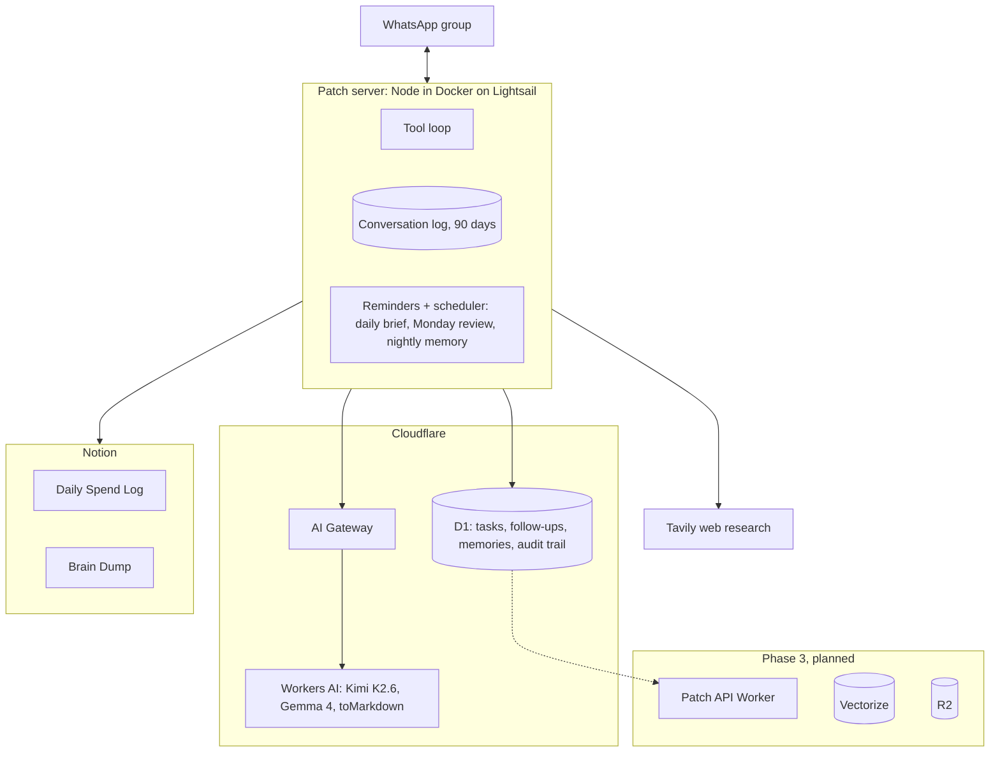
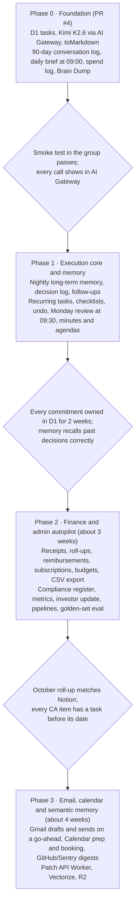

# Captain Patch: Chief of Staff Plan

Patch becomes Autter's chief of staff in three build phases on top of what ships now. It remembers every commitment made in the group, keeps 90 days of conversation and distills it into a lasting memory, runs the task list in Cloudflare D1, absorbs repetitive finance and admin work, and sends a daily brief and a Monday review written from what Sagnik and Tanvi actually said. Phase 0 is in review as PR #4; Phase 1 is built on top of it as its own PR.

The live, commentable version of this plan is a Claude Doc; this file is the copy that ships with the code.

## Ground rules

Every capability is checked against these before it ships.

1. **Grounded in the conversation.** Briefs, reviews, summaries, memory and drafts come from the group's own messages (who said what, what was decided, what was promised), cross-checked against the task list. If nobody said anything since the last brief, no brief is sent.
2. **Only the messages you chose.** Unprompted messages are limited to reminders a founder set, the daily brief (09:00 IST) and the Monday review (09:30 IST). No task digests, no mirroring Notion edits.
3. **Remember, don't hoard.** Raw conversation is kept 90 days on Patch's own server; what matters (decisions, commitments, people, facts) is distilled into long-term memory in D1, each item linked to the message it came from.
4. **One home per kind of data.** Tasks, follow-ups, decisions and memory live in D1. Money stays in the Notion Daily Spend Log. Raw ideas stay in the Notion Brain Dump.
5. **Writes are confirmed from stored data.** Every create, update or delete reply comes from what D1 or Notion returned, never from model prose. Deletes are soft and every change is audited.
6. **Acts outside the group only on a go-ahead.** Patch drafts emails and proposes meetings freely, but sends or books only after an explicit "send it" or "book it".
7. **Founders only, least privilege, observable spend.** Only Sagnik and Tanvi can command Patch; each integration gets the narrowest token; all model traffic goes through AI Gateway.

## What ships now (Phase 0)

PR #4 replaces the Notion task tracker and Azure OpenAI with D1 and Workers AI, keeps the spend log and Brain Dump, and grounds everything Patch sends in the group conversation.

| Area | Capability | How |
| --- | --- | --- |
| Tasks | Create single or batch tasks from text, quoted messages, voice notes and PDFs | `create_tasks` into D1 `tasks` |
| Tasks | Search by text, status, owner, area, tag, due range, overdue | `list_tasks` |
| Tasks | Edit any field, append or replace notes, clear fields; soft delete | `update_tasks`, `delete_tasks` |
| Tasks | Full history of every change with actor and before/after | `task_events` |
| Conversation | Every group message (and Patch's replies) kept locally for 90 days | local SQLite conversation log |
| Conversation | "What did we decide yesterday?", "turn today's discussion into tasks" | `read_group_conversation` |
| Briefs | Daily brief at 09:00 IST from the conversation since the last brief, plus open tasks and reminders; skipped if the group was quiet | scheduler, on by default |
| Safety | Edits and deletes only for an `#id` the founder named or that was just listed; action messages must call a tool | id guard, `tool_choice: required` |
| Money | Log many expenses in one message; query and total spend | Notion Daily Spend Log |
| Ideas | Read, append, and "research X and save it there" | Notion Brain Dump |
| Model | Kimi K2.6 via AI Gateway, automatic fallback to Gemma 4 on 429/5xx | Workers AI chat completions |
| Media | Screenshots via vision, PDFs and Office docs via Workers AI `toMarkdown`, voice via local Whisper | media ingestion |
| Removed | Notion task tracker and its tasks (starting fresh), four-hour digest, Notion webhook pings, Azure OpenAI | — |

## Capability map

Nine domains, each a capability, an example command, where the data lives, and the phase it lands in (0 = PR #4).

| Domain | Capability | Example | Data | Phase |
| --- | --- | --- | --- | --- |
| Execution | Task capture from text, voice, PDF, screenshot, quoted message | "turn this voice note into tasks" | `tasks` | 0 |
| Execution | Tasks from the group conversation | "capture everything we agreed today as tasks" | conversation log + `tasks` | 0 |
| Execution | Recurring tasks | "every month on the 5th: pay contractors" | `recurring_tasks` | 1 |
| Execution | Checklists inside a task | "checklist on #8: PAN, GST cert, board resolution" | `task_items` | 1 |
| Execution | Waiting-on and follow-up tracking | "I told Rahul I'd send the proposal by Friday" | `follow_ups` | 1 |
| Execution | Undo the last change | "undo that" | `task_events` | 1 |
| Execution | Monday review at 09:30 IST from last week's conversation and tasks | scheduled | conversation log + `tasks` | 1 |
| Money | Bulk spend logging and totals | "chai 120 upi, auto 260 cash" | Notion spend log | 0 |
| Money | Receipts from bill photos | send a photo | vision + spend log | 2 |
| Money | Monthly summary and founder reimbursements | "who owes whom for October?" | spend log | 2 |
| Money | Subscription radar and budgets | "what renews this month?" | `subscriptions`, `budgets` | 2 |
| Compliance | Register of filings and renewals from the CA, silent tasks ahead of each date | "what do we need for the annual filing?" | `compliance_items` | 2 |
| Memory | Brain Dump capture and research-and-save | "put this in the brain dump" | Notion | 0 |
| Memory | Search what was said in the group | "what did we decide about pricing on Monday?" | conversation log | 0 |
| Memory | Long-term memory distilled from the conversation: decisions, commitments, people, preferences and facts, kept after raw messages expire | "what do we know about Acme?" | `memories` | 1 |
| Memory | Decision log | "log decision: price per repo" | `memories` (kind decision) | 1 |
| Memory | Semantic memory across tasks, decisions, conversation, Brain Dump | "what have we said about SOC 2?" | Vectorize | 3 |
| Meetings | Minutes, tasks and decisions from a voice note | reply "minutes + tasks" | transcript | 1 |
| Meetings | Agenda from open, blocked tasks and recent discussion | "agenda for Thursday" | read-only | 1 |
| Meetings | Meeting prep and booking with calendar access | "prep me for the 4pm with Acme" | Google Calendar (read, book on request) | 3 |
| Comms | Drafts: emails, JDs, follow-ups, Dekhte Hai scripts | "draft a nudge to the designer" | none | 0 |
| Comms | Monthly investor update draft | "draft October's update" | tasks, metrics, spends, conversation | 2 |
| Comms | Gmail drafts, sent when a founder says "send it" | "put that in Gmail as a draft" | Gmail | 3 |
| Pipelines | Pilots, leads and hiring stages with next steps | "add Acme to pilots, next step DPA" | `pipeline`, `candidates` | 2 |
| Product ops | GitHub and Sentry digests on request, release-note drafts | "what merged this week?" | GitHub, Sentry | 3 |
| Metrics | Log KPIs from chat and ask for trends | "MRR 1.2L, 3 pilots" | `metrics` | 2 |

Patch gives no investment, tax or legal advice; it organizes numbers and deadlines the founders and their CA provide.

## Monotonous work Patch takes over

The target is 4+ founder hours a week back, mostly from capture, chasing and roll-ups.

| Chore today | What Patch does instead | Trigger | Phase |
| --- | --- | --- | --- |
| Copying action items out of chats and calls | Extracts them from the conversation and files owned tasks | Founder asks | 0 |
| Remembering who owns what and what's late | Answers instantly from D1 | Founder asks | 0 |
| Scrolling back to find what was agreed | Searches the group conversation | Founder asks | 0 |
| Writing a daily "where are we" and remembering what was said weeks ago | Brief from the day's conversation and open tasks; long-term memory for the rest | Daily at 09:00 IST | 0 / 1 |
| Typing expenses into Notion | Bulk logging from one message or a bill photo | Founder asks | 0 / 2 |
| Researching a vendor, competitor or question | Cited research, optionally saved to the Brain Dump | Founder asks | 0 |
| Tracking promises to customers and candidates | Follow-up tracker | Founder asks | 1 |
| Meeting agendas and recaps | From recent discussion, tasks and voice notes | Founder asks | 1 |
| Weekly review | Last week's conversation, done, slipped, next | Mondays at 09:30 IST | 1 |
| Monthly expense roll-up and reimbursements | Summary and settlement | Founder asks | 2 |
| Tracking SaaS renewals | Subscription radar | Founder asks | 2 |
| Chasing statutory and renewal deadlines | Tasks created ahead of each date, no pings | Automatic, silent | 2 |
| Writing the investor update | Draft from conversation, tasks, metrics, spends | Founder asks | 2 |

## Architecture

The group conversation stays on Patch's own server; tasks, follow-ups, decisions and memory go to D1, model calls go through AI Gateway, and Notion holds only spends and the Brain Dump.

Briefs and "what did we discuss" answers read the conversation log first. The Phase 3 Worker moves data tools behind a D1 binding once usage outgrows D1's REST API (about 1,200 requests per 5 minutes).

### D1 schema roadmap

Every new table follows the `tasks` pattern: soft delete, actor columns, timestamps, audited changes.

| Table | Holds | Phase |
| --- | --- | --- |
| `tasks`, `task_events` | Tasks and their audit trail | 0 |
| `conversation_messages` (local SQLite) | Group messages and Patch replies, 90-day retention | 0 |
| `recurring_tasks` | Template, owner, rule, next run | 1 |
| `task_items` | Checklist items inside a task | 1 |
| `follow_ups` | Counterparty, promise, due date, status | 1 |
| `memories` | Decisions (the decision log), commitments, facts, people and preferences, distilled nightly from the conversation or logged on request, each linked to its source message; kept after the 90-day log expires | 1 |
| `audit_events` | Shared audit trail for every new table | 1 |
| `subscriptions` | Vendor, amount, cycle, renewal date | 2 |
| `compliance_items` | Filing, authority, due date, lead days, checklist | 2 |
| `budgets` | Month, category, amount | 2 |
| `metrics` | Name, value, unit, as-of | 2 |
| `pipeline`, `candidates` | Stage, next step, owner | 2 |

## Model strategy and cost

Kimi K2.6 handles conversation and tool use; Gemma 4 covers fallback; everything is observed in AI Gateway.

| Role | Model | Why |
| --- | --- | --- |
| Primary chat and tools | `@cf/moonshotai/kimi-k2.6` | Strong tool calling, vision, 262k context; paid-only, lower per-account rate limit |
| Fallback | `@cf/google/gemma-4-26b-a4b-it` | Tools and vision, much cheaper, 300 requests/min |
| Embeddings (Phase 3) | `@cf/baai/bge-m3` | Semantic memory in Vectorize |
| Documents | Workers AI `toMarkdown` | PDFs and Office files become text open models can read |

- **Reasoning:** `none` for chat latency; `high` for background jobs (daily brief, Monday review, nightly memory) and research.
- **AI Gateway:** logging with a retention you choose, a gateway rate limit, a monthly spend alert, caching only for deterministic jobs.
- **Evaluation (Phase 2):** a 60-message golden set of real (anonymized) founder commands with expected tool calls, run before any model swap. Ship a model change only at 95%+ tool-selection accuracy and 100% on write-safety cases.

**Rough cost (approximate, verify in Gateway analytics):** a typical command is about 12k input and 0.6k output tokens across two rounds. At Kimi K2.6's listed $0.95 and $4.00 per million tokens that is about $0.014 per command, or about $20 a month at 50 commands a day, plus research runs, briefs, the nightly memory job and Workers Paid. D1 at this volume fits the included limits.

## Permissions

Patch stays founders-only: Sagnik and Tanvi have full access, everyone else gets a no-tools rejection, and there are no team-member roles.

| Who | Tasks, follow-ups, decisions, memory | Spends | Brain Dump | Conversation search | Email and calendar (Phase 3) |
| --- | --- | --- | --- | --- | --- |
| Founders | Full | Full | Read and append | The group they ask in | Drafts freely; sends and books on "send it" / "book it" |
| Anyone else | None (rejection) | None | None | None | None |

Conversation search and memory never cross groups: Patch only reads the log and memories of the group it was asked in.

## Roadmap

Phase 0 is in review as PR #4 and Phase 1 is built on top of it as its own PR; Phases 2 and 3 follow in about 7 weeks, each gated on a measurable result.

Phase 3 is done when nothing is ever sent or booked without a founder's go-ahead. Durations are estimates for one engineer working alongside the founders, not commitments.

## Success metrics

| Metric | Target |
| --- | --- |
| Commitments said in the group that end up as owned tasks | 90% or more |
| Brief items traceable to a message or task | 100% (no invented items) |
| Overdue open tasks | Falling week over week |
| Time from "add this" to confirmed task | Under 8 seconds at p50 |
| Tool-selection accuracy on the golden set | 95%+, 100% on write-safety cases |
| Unsolicited messages | Only reminders, the daily brief and the Monday review |
| Founder hours saved on admin | 4+ a week, self-reported |
| Model and platform cost | Under a set monthly budget, visible in AI Gateway |

## Decisions

Five decisions are made and built into the plan above; two are still open.

| Decision | Outcome | Where it lands |
| --- | --- | --- |
| Proactive messages | Both on: daily brief at 09:00 IST, Monday review at 09:30 IST (times configurable) | Brief in Phase 0, review in Phase 1 |
| Conversation retention | 90 days of raw messages, distilled into long-term memory that outlives them | Retention in Phase 0, memory in Phase 1 |
| Existing Notion tasks | Start fresh; nothing is migrated | Phase 0 |
| Gmail and Google Calendar | Yes: drafts and sends email, reads and books meetings, only after an explicit "send it" or "book it" | Phase 3 |
| Team-member roles | Not needed; Patch stays founders-only | Team mode removed from the roadmap |

Still open:

- [ ] The compliance and renewal list to load, from the CA (needed for Phase 2)
- [ ] AI Gateway log retention for prompts and replies
