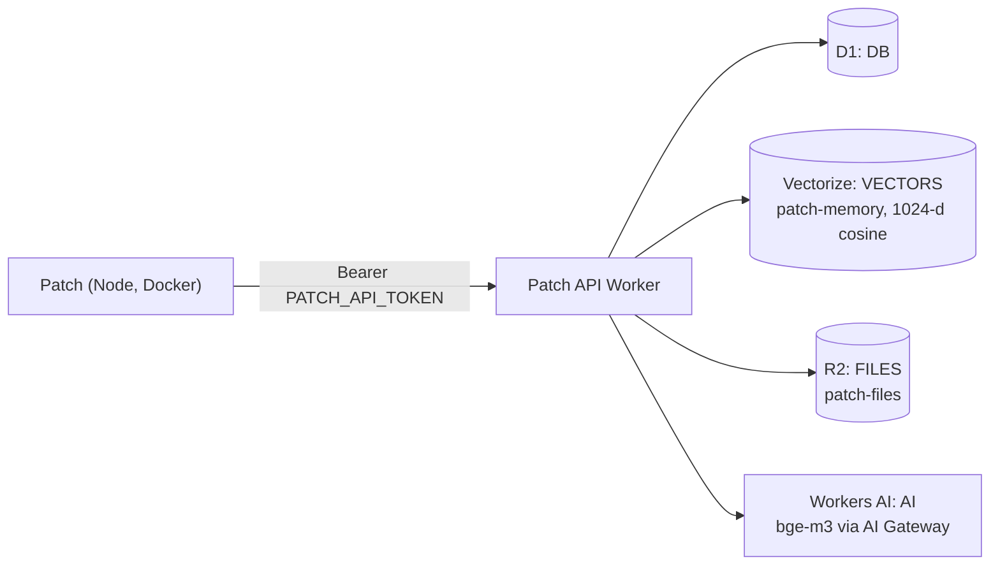

# Patch API Worker, semantic memory and attachment archive (Phase 3)

The Patch API Worker in `worker/` gives the bot three things it cannot get over Cloudflare's REST APIs alone:

- **D1 over a binding.** `POST /d1/query` takes the same `{sql, params}` body as D1's REST query endpoint and answers in the same shape, so the bot's stores run unchanged on top of it. Use it once usage outgrows the REST API's rate limit (about 1,200 requests per 5 minutes).
- **Semantic memory.** Long-term memories, tasks, founders' messages (when the conversation log is in D1) and Notion Brain Dump notes are embedded with `@cf/baai/bge-m3` (1,024 dimensions) into a Vectorize index. Founders can then ask "what have we said about SOC 2?" and get matches by meaning, with refs to cite.
- **Attachment archive.** Every attachment Patch ingests (voice notes, PDFs, screenshots) can be kept in R2 under `<groupId>/<YYYY>/<MM>/<messageId>-<fileName>`, with the key noted in the conversation log.

All three are off until you configure them. Patch still sends no new unprompted messages: the vector sync is silent.



## Routes

Every route requires `Authorization: Bearer <PATCH_API_TOKEN>`. The Worker compares the token in constant time and answers `401` otherwise. Errors use Cloudflare's envelope, `{success: false, errors: [{code, message}], result: null}`.

| Route | Body | Returns |
| --- | --- | --- |
| `POST /d1/query` | `{sql, params}`, one statement | `{success, errors, messages, result: [{success, results, meta: {changes, last_row_id, ...}}]}`, as D1's REST API. SQL errors are `400` with code 7500; an overloaded database is `429` so the bot retries. |
| `POST /vectors/upsert` | `{items: [{id, text, metadata: {group_id, kind, ref, ...}}]}`, up to 200 items | `{upserted, mutationIds}`. Embeds in batches of 50 and upserts, so re-sending an id replaces its vector. |
| `POST /vectors/query` | `{text, group_id, kind?, topK}`, `topK` 1-20 | `{matches: [{id, score, metadata}]}`. Always filtered to `group_id` plus company-wide items (`group_id` `*`), in the Vectorize query and again before returning. |
| `POST /vectors/delete` | `{ids: [...]}`, up to 200 ids | `{deleted}`. Removes vectors for deleted or edited-away rows; unknown ids are ignored. |
| `PUT /files/:key` | the file, with `Content-Type` and `Content-Length` | `201 {key, size, etag}`. Streams to R2. |
| `GET /files/:key` | | the file with its stored content type, or `404` |
| `DELETE /files/:key` | | `204` |

Vector ids are `memory:<id>`, `task:<id>`, `message:<id>` and `brain:<hash>`. Memories and messages carry their group's id; tasks and Brain Dump notes are company-wide and are indexed under `*`, so every group's search includes them.

## One-time setup

Run these from the `worker/` directory with a recent Wrangler (`npx wrangler@4 ...`, or a global install). Wrangler is not a project dependency.

1. **Log in.** `npx wrangler login`, on the same Cloudflare account as the bot.
2. **D1 binding.** Bind the database the bot already uses. Find its name and id with `npx wrangler d1 list`, then put both in `worker/wrangler.toml` under `[[d1_databases]]` (`database_name`, `database_id`; the binding stays `DB`). Optionally create the sync tables ahead of time; the bot also creates them on first sync:

   ```bash
   npx wrangler d1 execute <database-name> --remote --file=../migrations/0006_platform.sql
   ```

3. **Vectorize index.** Create it with bge-m3's dimensions, then add metadata indexes for the two filtered properties. Create the metadata indexes **before** the first sync: Vectorize only filters vectors inserted after a property is indexed.

   ```bash
   npx wrangler vectorize create patch-memory --dimensions=1024 --metric=cosine
   npx wrangler vectorize create-metadata-index patch-memory --property-name=group_id --type=string
   npx wrangler vectorize create-metadata-index patch-memory --property-name=kind --type=string
   ```

4. **R2 bucket.** `npx wrangler r2 bucket create patch-files`. Keep it private (no public access, no custom domain); files are reachable only through the Worker.
5. **Workers AI and AI Gateway.** The `[ai]` binding needs no setup. `AI_GATEWAY_ID` in `[vars]` (default `default`) sends embedding calls through the same AI Gateway as chat, so they show up in its logs and spend; set it to `""` to call Workers AI directly.
6. **Secret.** Generate a long random token and store it as a Worker secret, never in `wrangler.toml`:

   ```bash
   openssl rand -hex 32
   npx wrangler secret put PATCH_API_TOKEN
   ```

7. **Deploy.**

   ```bash
   npx wrangler deploy
   ```

   Wrangler prints the URL, for example `https://patch-api.<subdomain>.workers.dev`. Smoke test it:

   ```bash
   curl -s https://patch-api.<subdomain>.workers.dev/d1/query \
     -H "authorization: Bearer $PATCH_API_TOKEN" -H "content-type: application/json" \
     -d '{"sql":"SELECT COUNT(*) AS n FROM tasks","params":[]}'
   ```

   Without the header the same call must return `401`.

## Pointing the bot at it

Add to the bot's `.env` and restart the container (`docker compose up -d`):

```bash
PATCH_API_URL=https://patch-api.<subdomain>.workers.dev
PATCH_API_TOKEN=<the same token>
SEMANTIC_MEMORY=true        # optional
ARCHIVE_ATTACHMENTS=true    # optional
```

- With `PATCH_API_URL` and `PATCH_API_TOKEN` set, every D1 store (tasks, memory, follow-ups, recurring tasks, checklists, the conversation log, sync state) goes through `/d1/query` instead of the REST API. The startup log shows `d1Route: "patch-api-worker"`. `CLOUDFLARE_D1_DATABASE_ID` is still required; keep it pointing at the same database so you can roll back by clearing `PATCH_API_URL`.
- `SEMANTIC_MEMORY=true` adds the `semantic_search` tool and a silent background job that runs about every 10 minutes. It keeps a cursor per source in D1's `vector_sync_cursor` table and advances it only after the Worker accepted the batch. The first runs backfill everything that already exists, 500 rows per source per run.
  - **Memories:** new ones are embedded once; forgotten ones are removed from the index.
  - **Tasks:** follow `updated_at`, so new, edited, deleted and restored tasks are re-embedded or removed.
  - **Messages:** with the conversation log in D1 (`CONVERSATION_STORE=auto` or `d1`), founders' messages of 20 characters or more are embedded. Patch's own replies are not.
  - **Brain Dump:** when `NOTION_BRAIN_DUMP_PAGE_ID` is set, the page is read about once an hour (up to 400,000 characters), split into notes of about 1,200 characters at each heading, and stored in `brain_dump_chunks` keyed by a hash of each note. New notes are embedded and notes removed in Notion are deleted from the index. If the read was cut short, nothing is deleted.
- `ARCHIVE_ATTACHMENTS=true` uploads each attachment Patch ingests (only messages that trigger Patch, or the message they quote) in the background, then records `📎 Archived <file> as <key>` in the conversation log. A failed upload is logged and never blocks the reply.

Both flags need `PATCH_API_URL`; config validation fails at startup otherwise.

### Using semantic search

The model prefers `semantic_search` for fuzzy or conceptual questions and keeps `search_memory` for exact names and words. Each match carries what the reply cites: `M<id>` for a memory, `#<id>` for a task, who said it and when for a message, and the heading for a Brain Dump note. Matches are re-read from D1 before they reach the model, so a forgotten memory, deleted task or pruned message never surfaces, and another group's memory or message is dropped even if the index returned it. The tool only offers the kinds that are switched on.

## Limits and known gaps

- **Vectorize.** Writes become queryable a few seconds after an upsert. `topK` is capped at 20 because the Worker returns full metadata. Vector ids are at most 64 bytes, and metadata is capped at 8 KiB per vector here (Vectorize allows 10 KiB). Filtering only works on indexed properties (`group_id`, `kind`), and only for vectors inserted after the metadata index existed.
- **Embedding text.** Each item's text is cut to 6,000 characters, well inside bge-m3's 8,192-token window, and task notes to 3,000 before that.
- **Sync freshness.** New memories, tasks and messages are searchable within about 10 minutes, Brain Dump notes within about an hour. Every task edit re-embeds the task, including status changes. Messages pruned after the 90-day retention keep their vectors in the index, but search never returns them because the row is gone from D1.
- **D1 route.** One statement per request, like the bot's current use of the REST API; multi-statement strings and `batch` are not supported. Worker and D1 limits apply instead of the REST API's rate limit.
- **R2 route.** Uploads need `Content-Length` and are capped at 25 MB (the bot's `MEDIA_MAX_BYTES` is at most 25,000,000). Keys are at most 1,024 bytes and may not contain empty, `.` or `..` segments.
- **Auth.** One shared bearer token, which grants full read and write on the database, the index and the bucket. Rotate it with `wrangler secret put PATCH_API_TOKEN` and the bot's `.env` together. For defense in depth, consider Cloudflare Access service tokens in front of the Worker.
- **Brain Dump edits.** Editing a note in Notion changes its hash, so the old version is removed and the new one embedded on the next hourly read.

## Development

The handlers are plain functions in `worker/src/index.ts` that take the bindings as parameters; `worker/src/bindings.ts` declares the small slice of each binding they use, so there is no `@cloudflare/workers-types` dependency. `test/platform.test.ts` runs them in Node with fake D1 (SQLite), Vectorize, R2 and Workers AI bindings, together with the bot-side clients. `npm run check` lints and typechecks `worker/` with the rest of the repo. Use `npx wrangler dev` in `worker/` (with `--remote` for the Vectorize binding) to try it against real bindings.

## Conversation log in D1

Once `PATCH_API_URL` is set, the group conversation moves from local SQLite into the D1 table `conversation_messages` (`migrations/0007_conversation.sql`). This is the founders' decision, controlled by `CONVERSATION_STORE=auto`; use `local` to keep it on the server or `d1` to force it. On the first start after the switch, Patch copies the history still inside `CONVERSATION_RETENTION_DAYS` into D1 and clears the local table, so nothing is stored twice. Re-running is safe, since D1 dedupes on message id. Each message is one write through the Worker's binding, which avoids the REST API's request limit.

